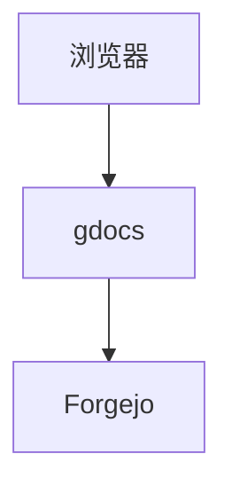

# 文档仓库规范

一个来源对应一个 Git 仓库的某个分支和可选子目录。站点读取该目录下的 Markdown 文件，并把目录结构映射为侧栏。

## 目录结构

```text
仓库/
├── README.md
├── _meta.yaml
├── 入门/
│   ├── README.md
│   ├── _meta.yaml
│   ├── 安装.md
│   └── 配置.md
└── 运维/
    ├── 部署.md
    └── 备份.md
```

规则：

- 只有 `.md` 文件会进入索引，扩展名不区分大小写。
- 单个文档最大 2 MiB，`_meta.yaml` 最大 1 MiB，超出会被跳过并记录日志。
- 目录层级就是侧栏层级。某个目录下没有匿名可见文档时，整个目录不会显示。
- 来源配置了 `root` 时，只读取该子目录；`root` 之外的改动不会出现在站点。
- 索引通过下载仓库归档建立，默认上限 50 MiB，可通过 `index.max_archive_mb` 调整。

## front-matter

Markdown 文件可以在开头写 YAML front-matter：

```markdown
---
title: 部署说明
order: 10
public: false
draft: false
---

正文从这里开始。
```

| 字段 | 类型 | 说明 |
|---|---|---|
| `title` | 字符串 | 页面标题。未填写时使用文件名；`README.md` 使用所在目录名，根目录的 `README.md` 显示为“首页” |
| `order` | 整数 | 未写入 `_meta.yaml` 时的排序权重，数值小的在前 |
| `public` | 布尔 | 是否允许匿名阅读。未填写时继承 `server.public_read` |
| `draft` | 布尔 | 草稿。`true` 时只有登录用户可以访问 |

front-matter 必须从文件第一行 `---` 开始，并以单独一行的 `---` 结束。找不到结束标记时整篇按普通正文处理；YAML 解析失败时字段按空值处理。

### 可见性

匿名用户的判断顺序：

1. `draft: true`：不可见，直接访问返回 404。
2. `public` 有显式值：按该值决定。
3. `public` 未填写：继承 `server.public_read`。

登录用户可以访问所有草稿和私有文档。草稿不会因为 `public: true` 而对匿名用户开放。

站点没有按用户或用户组分配单篇文档权限的能力，只有“匿名可见”和“登录可见”两档。

### 排序

每个目录可以放一个 `_meta.yaml`，按文件名列出顺序：

```yaml
order:
  - README.md
  - 安装.md
  - 配置.md
```

规则：

- 名称是同级文件名（含 `.md`）或子目录名。
- 目录始终排在文档前面。
- 同类型内，先按 `_meta.yaml` 中的位置排序。
- 未出现在 `_meta.yaml` 中的文档，按 front-matter 的 `order` 排序；没有 `order` 时按名称排序。
- 侧栏的上下箭头只调整同级文档顺序，并自动重写当前目录的 `_meta.yaml`。
- 子目录顺序需要手动编辑 `_meta.yaml`。

`_meta.yaml` 是站点会主动写入仓库的额外文件。手动编辑时保留 `order` 一个字段即可。

### 移动与删除

- 移动文档会在目标路径创建新文件，再删除旧文件，因此会产生两次提交。
- 移动不会自动改写原目录或目标目录的 `_meta.yaml`。移动后可在侧栏重新排序一次，或手动修正。
- 删除文档不会清理 `_meta.yaml` 中的旧名称，残留项不影响使用。
- 保存和删除使用文件 SHA 校验，文件在操作期间被他人修改时会提示刷新后重试。
- 移动会先读取当前文件，再创建目标文件并删除原文件；目标已存在或原文件在此期间变化时会失败。

## Markdown 能力

正文由 Cherry Markdown 渲染，支持：

- 常用 Markdown 语法与表格。
- 围栏代码块和 highlight.js 语法高亮。
- Mermaid 图表：

````markdown

````

- 数学公式，支持 `$...$`、`$$...$$`、`\(...\)`、`\[...\]`。
- 图片，编辑器上传后自动插入 S3 地址。
- 标题目录：页面会提取正文中的三级标题生成右侧目录。

## 图片

编辑器工具栏上传图片后，服务端把文件写入 S3，并把返回地址插入正文。

- 支持 PNG、JPEG、GIF、WebP、SVG。
- 默认单文件上限 10 MiB，由 `s3.max_size_mb` 控制。
- 扩展名和实际内容必须匹配。
- `s3.public_base` 必须是浏览器可访问的地址，否则图片会打不开。
- 没有配置 S3 时上传接口返回“图片存储未配置”。

## 提交信息

站点写入仓库时会生成以下提交信息：

| 操作 | 提交信息 |
|---|---|
| 新建 | `docs: create <路径>` |
| 保存 | `docs: update <路径>` |
| 删除 | `docs: delete <路径>` |
| 移动 | `docs: move <原路径> to <新路径>` |
| 导入 | `docs: import <路径>` |
| 排序 | `docs: reorder <目录>` |

提交作者使用当前登录用户的显示名称和邮箱，邮箱缺失时回落到 `git.bot_email`。

## 导入已有 Markdown

编辑者可以把一个或多个 `.md` 文件拖到正文区域：

- 文件会被导入当前所在目录。
- 文件名就是目标路径，重名会失败。
- 文件已有的 front-matter 会保留；没有 front-matter 时自动补 `title`。
- 只接受 `.md` 文件，目录不会被递归导入。
